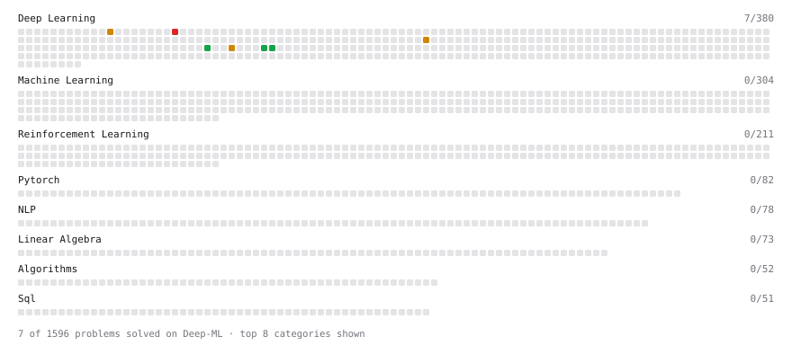

# Deep-ML

My machine learning practice from [Deep-ML](https://www.deep-ml.com). Every solution here was written by hand.

**14** solved · 11 problems · 1 labs · 2 math

[**Browse the interactive portfolio**](https://ChulanZhang.github.io/deep-ml/) to replay this filling in over time.

## Problems

| | Difficulty | Solved | |
| --- | --- | --- | --- |
| [Compare Naive vs Stable Softmax for Attention Scores](https://www.deep-ml.com/problems/962) | easy | 2026-10-18 | [solution](problems/0962-compare-naive-vs-stable-softmax-for-attention-scores) |
| [Scale Attention Scores by sqrt(d_k)](https://www.deep-ml.com/problems/963) | easy | 2026-10-18 | [solution](problems/0963-scale-attention-scores-by-sqrt-d-k) |
| [Simple Self-Attention Without Trainable Weights](https://www.deep-ml.com/problems/955) | easy | 2026-10-18 | [solution](problems/0955-simple-self-attention-without-trainable-weights) |
| [Batched Attention Score Computation for Multiple Heads](https://www.deep-ml.com/problems/966) | medium | 2026-10-18 | [solution](problems/0966-batched-attention-score-computation-for-multiple-heads) |
| [Build Scaled Dot-Product Attention](https://www.deep-ml.com/problems/490) | medium | 2026-10-18 | [solution](problems/0490-build-scaled-dot-product-attention) |
| [Implement Self-Attention Mechanism](https://www.deep-ml.com/problems/53) | medium | 2026-10-18 | [solution](problems/0053-implement-self-attention-mechanism) |
| [Multi-Head Attention via Head Stacking](https://www.deep-ml.com/problems/958) | medium | 2026-10-18 | [solution](problems/0958-multi-head-attention-via-head-stacking) |
| [Multi-Head Attention with Combined QKV Weight Matrix](https://www.deep-ml.com/problems/959) | medium | 2026-10-18 | [solution](problems/0959-multi-head-attention-with-combined-qkv-weight-matrix) |
| [Implement Multi-Head Attention](https://www.deep-ml.com/problems/94) | hard | 2026-10-15 | [solution](problems/0094-implement-multi-head-attention) |
| [Implement Multi-Head Attention Using Einsum](https://www.deep-ml.com/problems/960) | hard | 2026-10-18 | [solution](problems/0960-implement-multi-head-attention-using-einsum) |
| [Implement Multi-Head Self-Attention](https://www.deep-ml.com/problems/904) | hard | 2026-10-18 | [solution](problems/0904-implement-multi-head-self-attention) |

## Labs

| | Difficulty | Solved | |
| --- | --- | --- | --- |
| [Design Your Own Attention Mechanism](https://www.deep-ml.com/labs/10) | medium | 2026-10-19 | [solution](labs/0010-design-your-own-attention-mechanism) |

## Math

| | Difficulty | Solved | |
| --- | --- | --- | --- |
| [Attention as a Soft Dictionary Lookup](https://www.deep-ml.com/math-problems/133) | easy | 2026-10-18 | [solution](math/0133-attention-as-a-soft-dictionary-lookup) |
| [Why Scale by sqrt(d_k)](https://www.deep-ml.com/math-problems/230) | medium | 2026-10-18 | [solution](math/0230-why-scale-by-sqrt-d-k) |

---

_This file is regenerated by Deep-ML on every push._
